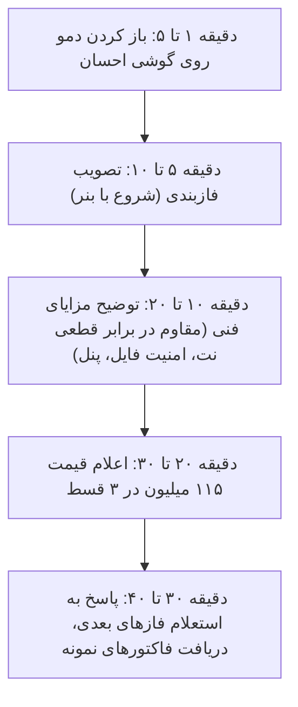

<div dir="rtl">

# کتابچه راهنمای جامع و اختصاصی مذاکره و توسعه (مخصوص فرزاد بهادری‌فر)
## پروژه سامانه آنلاین «چاپ احسان» — فاز اول و چشم‌انداز محصول

**هدف این سند:** این راهنما، برگه تقلب (Cheat Sheet)، چارچوب استراتژیک مذاکره، و مرجع فنی برآورد واقع‌بینانه فاز اول و کلیه فازهای آتی برای جلسه با احسان است.

---

### ۱. شناسنامه فنی و معماری پروژه

| لایه | فناوری انتخابی | دلیل فنی و مزیت رقابتی |
| :--- | :--- | :--- |
| **فرانت‌اند** | Angular (Standalone Components) | رابط کاربری سازمانی، لایت‌مود سفید مینیمال، بدون وابستگی به اینترنت خارجی |
| **بک‌اند** | ASP.NET Core (.NET 10 LTS) | سرعت بالا، مصرف بهینه RAM، پایداری فوق‌العاده روی لینوکس داکر |
| **دیتابیس** | PostgreSQL | پایگاه داده رابطه‌ای قدرتمند، سبک و بدون چالش لایسنس |
| **ذخیره فایل** | Local Private Storage | فایل‌های حجیم TIFF/PDF خارج از وب‌سرور ذخیره شده و با اعتبارسنجی ادمین دانلود می‌شوند |
| **استقرار** | Docker Compose + Nginx | استقرار روی سرورهای داخلی با قابلیت پایداری کامل در شرایط محدودیت اینترنت بین‌الملل |

---

### ۲. فرمول‌های ریاضی و منطق سفارش بنر

احسان در پیام‌هایش اشاره کرده: «زیر یک متر، یک متر حساب می‌شود». در جلسه باید این فرمول نهایی شود:

* **حالت استاندارد کارگاه:**
  $$\text{Area} = \frac{\text{Width (cm)} \times \text{Height (cm)}}{10000}$$
  اگر مساحت کمتر از $1.0\text{ m}^2$ باشد، مساحت صورت‌حساب برابر با $1.0\text{ m}^2$ گرد می‌شود.
* **خدمات تکمیلی:**
  * **پانچ (حلقه‌های فلزی گوشه‌ها و دور):** تعداد پانچ $\times$ تعرفه هر عدد (مثلاً هر عدد ۵ هزار تومان).
  * **ولد / دوردوزی (تقویت لبه‌ها):** محیط بنر $2 \times (\text{Width} + \text{Height})$ بر حسب متر $\times$ تعرفه متری ولد.
* **تعرفه متریال:** تعرفه پایه بنر ۱۳ انس یا ۱۰ انس ضربدر مساحت نهایی.

> **نکته کلیدی جلسه:** در جلسه از احسان بخواهید ۵ فاکتور اخیر کارگاه را نشان دهد تا مطمئن شوید منطق محاسبه مساحت در سیستم با نرم‌افزار حسابداری یا چرتکه کارگاه او ۱ ریال هم اختلاف ندارد.

---

### ۳. مدیریت زمان فرزاد، ظرفیت واقعی و رفع توهم سرعت

* **ظرفیت واقعی شما (بعد از ساعت ۱۷:۰۰):**
  * شنبه تا چهارشنبه: روزی ۳ ساعت متمرکز (از ساعت ۱۷:۳۰ تا ۲۰:۳۰) = ۱۵ ساعت در هفته.
  * پنجشنبه: اختیاری / استراحت.
  * جمعه: ۵ تا ۶ ساعت کار متمرکز.
  * **مجموع ظرفیت کاری مفید هفتگی:** **۲۰ تا ۲۲ ساعت کار خالص**.
* **برآورد واقع‌بینانه فاز اول:**
  * تلاش پایه: ۱۴۰ تا ۱۵۰ ساعت.
  * با احتساب ۲۰٪ ذخیره عدم قطعیت و چالش‌های بانکی/شبکه: **۱۶۸ تا ۱۸۰ ساعت**.
  * زمان تقویمی واقعی: **۸ تا ۱۰ هفته کاری** (نه ۵ تا ۶ هفته!).
* **ارزش‌گذاری و دستمزد:**
  * نرخ پایه کارشناسی توسعه اختصاصی: **۸۰۰ هزار تومان در ساعت**.
  * ارزش کارشناسی فاز اول: $170 \times 800,000 = \text{۱۳۶ میلیون تومان}$.
  * مبلغ پیشنهادی **۱۱۵ میلیون تومان** در عمل با **حداقل ۲۰ میلیون تومان تخفیف همکاری/ریسک اولیه** در نظر گرفته شده است و کف غیرقابل شکستن است.
* **اصل طلایی:** هرگز به خاطر تعجیل مشتری، قول تحویل زیر ۷-۸ هفته ندهید؛ خستگی تجمعی نباید کیفیت کار اصلی روزانه یا سلامت شما را تحت تاثیر قرار دهد.

---

### ۴. سناریوی گام‌به‌گام جلسه بعدازظهر با احسان



#### گام ۱: ارائه دموی زنده روی موبایل کارفرما (برتری روانی)
* **دیالوگ:** *«احسان جان، قبل از هر صحبتی، من بر اساس پیام‌های قبلی، پیش‌طرح کامل و تعاملی ۱۴ صفحه رو زدم و روی نت گذاشتم. این آدرس رو روی گوشیت باز کن: `farzad-bahadorifar.github.io/chapehsan`... ببین فرم بنر چقدر روون کار می‌کنه و روی موبایل چقدر سبکه.»*

#### گام ۲: تصویب فازبندی هوشمند
* **دیالوگ:** *«همان‌طور که خودت پیشنهاد دادی، بهترین استراتژی اینه که سایت با هر ۶ تا خدمت بالا بیاد، ولی سفارش آنلاین رو اول برای بنر کامل کنیم تا سایت ظرف ۸ هفته بره تو خط درآمدزایی. بقیه خدمات با دکمه تماس باشن و بعداً یکی‌یکی فعال بشن.»*

#### گام ۳: اعلام قیمت، اقساط و شفافیت هزینه‌ها
* **دیالوگ:** *«برای پیاده‌سازی اختصاصی این فاز اول، ۱۴۰ تا ۱۵۰ ساعت کار مهندسی مفیده. با احتساب آزمون‌ها دستمزد ۱۱۵ میلیون تومان می‌شه که تو ۳ مرحله متناسب با پیشرفت پروژه پرداخت می‌کنی: ۳۴٫۵ میلیون پیش‌پرداخت، ۴۶ میلیون بعد از دیدن نسخه آزمایشی، و ۳۴٫۵ میلیون بعد از استقرار و تحویل نهایی. هزینه‌های دامنه، هاست و پنل پیامک هم شفاف مستقیماً به نام خودت ثبت و فاکتور میشه.»*

---

### ۵. ماتریس مواجهه با بهانه‌ها و چانه‌زنی‌های احتمالی

| بهانه / اعتراض احتمالی | پاسخ حرفه‌ای و خونسرد شما | خط قرمز و تصمیم |
| :--- | :--- | :--- |
| **«خیلی گرونه، فلان جا با ۳۰ تومن سایت می‌زنه»** | *«درسته، برای فروشگاه لباس با قالب آماده وردپرس قیمت همینه. اما تو چاپخانه فایل‌های سنگین ۲۰۰ مگابایتی هست، محاسبه ابعاد سانتی‌متری داری، و نباید با قطعی اینترنت بخوابه. سیستم اختصاصی صنعتی سرمایه‌گذاری متفاوتیه.»* | **خط قرمز:** هرگز قیمت را زیر ۱۰۰ میلیون نشکنید. کار شبانه در ازای پول کم ارزش ندارد. |
| **«۱۱۵ تومن قبوله ولی همه ۶ تا خدمت رو آنلاین کن»** | *«فرمول هر محصول فرق داره؛ پوستر ضخامت شاسی داره، پرچم ابعاد و پایه داره. اگه همه رو الان بخوایم، کار بالای ۵ ماه طول می‌کشه. منطق تجاری میگه اول بنر به درآمد برسه، از سودش بقیه رو اضافه کنیم.»* | روی مرز فاز اول بایستید تا درگیر اضافه کاری بی‌پایان (Scope Creep) نشوید. |
| **«بیا درصدی یا شراکتی کار کنیم»** | *«من تخصصم توسعه نرم‌افزاره و شما تخصصت چاپ و بازاریابی. بهترین همکاری اینه که سامانه شما ملکتون باشه و من هم دستمزد مشخص بگیرم تا تعهدم شفاف باشه.»* | هرگز وارد مدل درصدی مبهم نشوید. |

---

### ۶. سناریوی خروج محترمانه (اگر کارفرما توافق نکرد)

اگر احساس کردید احسان بودجه‌اش در حد ۳۰ تا ۵۰ میلیون است یا می‌خواهد با اصرار تعهدات غیرمنطقی ایجاد کند، کاملاً آرام و صمیمانه بگویید:
> *«احسان جان، خیلی خوشحالم که در مورد پروژه‌ات صحبت کردیم. اگر در حال حاضر اولویت چاپخانه سرمایه‌گذاری متفاوتیه، کاملاً طبیعیه. وایرفریم‌ها و این طرح دستت باشه؛ هر زمان احساس کردی چاپخانه آماده داشتن یک سامانه اختصاصی و بدون قطعی هست، با کمال میل در خدمتت هستم.»*

---

### ۷. برآورد واقع‌بینانه فازهای بعدی و بقیه ماژول‌ها (پاسخ به سوال کارفرما)

اگر احسان پرسید: **«هزینه و زمان بقیه بخش‌ها چقدر می‌شود؟»**، برآورد مهندسی و واقع‌بینانه به تفکیک ماژول‌ها به شرح زیر است:

```
┌────────────────────────────────────────────────────────────────────────┐
│                        برآورد فازهای توسعه آتی چاپ احسان               │
├─────────────────────┬──────────────────┬───────────────┬───────────────┤
│ ماژول               │ سختی فنی         │ نفرساعت برنامه‌│ زمان تقویمی   │
├─────────────────────┼──────────────────┼───────────────┼───────────────┤
│ ۱. پوستر، شاسی و فوم│ متوسط            │ ۳۵ تا ۴۵ ساعت │ ۱٫۵ تا ۲ هفته │
│ ۲. پلات، لمینت، اکو │ متوسط رو به بالا │ ۴۰ تا ۵۵ ساعت │ ۲ تا ۲٫۵ هفته │
│ ۳. استیکر، مش و برش │ بالا             │ ۴۵ تا ۶۰ ساعت │ ۲ تا ۳ هفته   │
│ ۴. سازه‌های نمایشگاه│ متوسط            │ ۳۰ تا ۴۰ ساعت │ ۱٫۵ هفته      │
│ ۵. پرچم‌ها          │ متوسط رو به بالا │ ۳۵ تا ۴۸ ساعت │ ۱٫۵ تا ۲ هفته │
│ ۶. پنل پیامکی و OTP │ متوسط            │ ۳۸ تا ۵۲ ساعت │ ۲ تا ۲٫۵ هفته │
│ ۷. موتور بررسی فایل │ بالا             │ ۴۸ تا ۶۵ ساعت │ ۲٫۵ تا ۳ هفته │
│ ۸. قیمت‌گذاری همکار  │ متوسط رو به بالا │ ۳۲ تا ۴۵ ساعت │ ۱٫۵ تا ۲ هفته │
│ ۹. اتوماسیون کارگاه │ بالا             │ ۵۰ تا ۷۰ ساعت │ ۲٫۵ تا ۳٫۵ هفته│
│ ۱۰. طراحی آنلاین    │ بسیار بالا       │ ۷۰ تا ۹۵ ساعت │ ۳٫۵ تا ۴٫۵ هفته│
└─────────────────────┴──────────────────┴───────────────┴───────────────┘
```

#### جزئیات دسته‌های چاپی جدید:
1. **پوستر و تخته‌شاسی / فوم‌برد:** ابعاد استاندارد و دلخواه، ضخامت‌های ۳، ۸ و ۱۶ میل MDF با نوار لبه، فوم‌برد ۵ و ۱۰ میل.  
   *زمان:* ۳۵ تا ۴۵ ساعت (~۱٫۵ تا ۲ هفته) | *برآورد ارزش:* ۲۸ تا ۳۶ میلیون تومان.
2. **پلات، لمینت و اکوسالونت:** کاغذ کوتد ۹۰ تا ۱۸۰ گرم، گلاسه، بوم، بک‌لایت؛ لمینت مات و براق (سرد و گرم)؛ احتساب پرتی عرض رول.  
   *زمان:* ۴۰ تا ۵۵ ساعت (~۲ تا ۲٫۵ هفته) | *برآورد ارزش:* ۳۲ تا ۴۴ میلیون تومان.
3. **استیکر و مش و برش:** استیکر شیری، شیشه‌ای، شبرنگ، مش؛ برش نیم‌تیغ، دوربُر کاترپلاتر با خط تیغ وکتور؛ سلفون‌کشی.  
   *زمان:* ۴۵ تا ۶۰ ساعت (~۲ تا ۳ هفته) | *برآورد ارزش:* ۳۶ تا ۴۸ میلیون تومان.
4. **سازه‌های نمایشگاهی:** رول‌آپ (۸۵ تا ۲۰۰ سانت)، استند ایکس (۶۰×۱۶۰ و ۹۰×۲۰۰)؛ سفارش سازه کامل یا فقط چاپ تعویضی.  
   *زمان:* ۳۰ تا ۴۰ ساعت (~۱٫۵ هفته) | *برآورد ارزش:* ۲۴ تا ۳۲ میلیون تومان.
5. **پرچم‌ها:** رومیزی (ساتن مات/براق با پایه سنگی/فلزی)، تشریفات مخروطی و ریشه‌دار، ساحلی/بادبانی (۲٫۵ تا ۳٫۵ متر با پایه مخزن آب).  
   *زمان:* ۳۵ تا ۴۸ ساعت (~۱٫۵ تا ۲ هفته) | *برآورد ارزش:* ۲۸ تا ۳۸ میلیون تومان.

#### جزئیات ماژول‌های توسعه سیستم:
6. **ورود پیامکی و باشگاه مشتریان (OTP Auth & Portal):** ثبت‌نام بدون رمز با شماره موبایل، سوابق خرید، فاکتور، تکرار سفارش با ۱ کلیک.  
   *زمان:* ۳۸ تا ۵۲ ساعت (~۲ هفته) | *برآورد ارزش:* ۳۰ تا ۴۰ میلیون تومان.
7. **موتور بررسی خودکار فایل (Preflight Engine):** استخراج رزولوشن (DPI)، فضای رنگی (CMYK/RGB)، تناسب ابعاد و ساخت پیش‌نمایش سبک.  
   *زمان:* ۴۸ تا ۶۵ ساعت (~۲٫۵ تا ۳ هفته) | *برآورد ارزش:* ۳۸ تا ۵۰ میلیون تومان.
8. **قیمت‌گذاری پلکانی و پنل همکاران (B2B Tiered):** درصد تخفیف ویژه آژانس‌ها و طراحان، تخفیف متراژ بالا، تسویه اعتباری.  
   *زمان:* ۳۲ تا ۴۵ ساعت (~۱٫۵ تا ۲ هفته) | *برآورد ارزش:* ۲۵ تا ۳۶ میلیون تومان.
9. **اتوماسیون کارگاه و بارکد (Workshop Flow):** مانیتورهای خط تولید اپراتورها، تولید بارکد/QR، پیامک خودکار مراحل تولید به مشتری.  
   *زمان:* ۵۰ تا ۷۰ ساعت (~۲٫۵ تا ۳٫۵ هفته) | *برآورد ارزش:* ۴۰ تا ۵۶ میلیون تومان.
10. **طراحی آنلاین مناسبتی (Template Customizer):** قالب‌های آماده ترحیم/تبریک/افتتاحیه، ویرایش متن و عکس آنلاین، خروجی آماده چاپ.  
    *زمان:* ۷۰ تا ۹۵ ساعت (~۳٫۵ تا ۴٫۵ هفته) | *برآورد ارزش:* ۵۶ تا ۷۶ میلیون تومان.

#### نحوه پاسخ بسته‌بندی‌شده به احسان در جلسه:
> *«احسان جان، حُسن طراحی ماژولار اینه که تو همین اول مجبور نیستی برای کل این موارد چندصد میلیون هزینه کنی. فاز اول (بنر) رو که بالا بیاریم و وارد فاز درآمدزایی بشی، بر اساس تقاضای مشتری‌هات دسته‌ها رو مرحله‌به‌مرحله اضافه می‌کنیم. مثلاً تو فاز دوم پوستر و پلات رو با هم میاریم بالا (حدود ۴ هفته، ۶۰-۷۰ میلیون)، بعدش استیکر و سازه‌ها رو اضافه می‌کنیم. اینطوری ریسک مالی نداری و نرم‌افزار هم‌گام با بیزینس خودت رشد می‌کنه.»*

</div>
