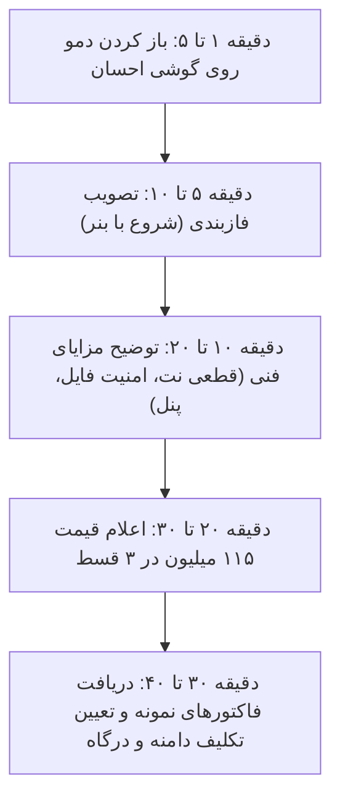

# کتابچه راهنمای جامع و اختصاصی مذاکره و توسعه (مخصوص فرزاد بهادری‌فر)
## پروژه سامانه آنلاین «چاپ احسان» — فاز اول و چشم‌انداز محصول

**هدف این سند:** این راهنما، برگه تقلب (Cheat Sheet) و چارچوب استراتژیک شما برای جلسه حضوری/تلفنی با احسان، نحوه قیمت‌گذاری، پاسخ به چالش‌ها و مدیریت ظرفیت کاری بعد از ساعت ۵ عصر است.

---

### ۱. شناسنامه فنی و معماری پروژه

| لایه | فناوری انتخابی | دلیل فنی و مزیت رقابتی |
| :--- | :--- | :--- |
| **فرانت‌اند** | Angular 19/20 (Standalone Components) | رابط کاربری سازمانی، لایت‌مود سفید مینیمال، عدم وابستگی به اینترنت خارجی |
| **بک‌اند** | ASP.NET Core (.NET 10 LTS) | سرعت بالا، مصرف ناچیز RAM، پایداری فوق‌العاده روی لینوکس داکر |
| **دیتابیس** | PostgreSQL 17 | پایگاه داده رابطه‌ای قدرتمند، سبک و بدون تحریم |
| **ذخیره فایل** | Local Private Storage | فایل‌های حجیم TIFF/PDF خارج از وب‌سرور ذخیره شده و فقط با توکن ادمین دانلود می‌شوند |
| **استقرار** | Docker Compose + Nginx | استقرار روی دیتاسنترهای داخلی ایران با قابلیت کارکرد کامل در زمان قطعی اینترنت بین‌الملل |

---

### ۲. فرمول‌های ریاضی و منطق سفارش بنر

احسان در پیام‌هایش اشاره کرده: «زیر یک متر، یک متر حساب می‌شود». در جلسه باید این فرمول نهایی شود:

* **حالت استاندارد کارگاه:**
  $$\text{Area} = \frac{\text{Width (cm)} \times \text{Height (cm)}}{10000}$$
  اگر مساحت کمتر از $1.0\text{ m}^2$ باشد، مساحت صورت‌حساب برابر با $1.0\text{ m}^2$ گرد می‌شود.
* **خدمات تکمیلی:**
  * **پانچ (حلقه‌های فلزی گوشه‌ها و دور):** تعداد پانچ $\times$ تعرفه هر عدد (مثلاً هر عدد ۵ هزار تومان).
  * **ولد / دوردوزی (تقویت لبه‌ها):** محیط بنر $2 \times (\text{Width} + \text{Height})$ بر حسب متر $\times$ تعرفه متری ولد.
* **تعرفه متریال:** تعرفه پایه بنر ۱۳ انس یا ۱۰ انس ضربدر مساحت نهایی.

> **نکته کلیدی جلسه:** در جلسه از احسان بخواهید ۵ فاکتور اخیر کارگاه را نشان دهد تا مطمئن شوید منطق محاسبه مساحت در سیستم با نرم‌افزار حسابداری یا چرتکه کارگاه او ۱ ریال هم اختلاف ندارد.

---

### ۳. مدیریت زمان فرزاد و مرزهای کاری (بعد از ساعت ۱۷)

* **ظرفیت واقعی شما:**
  * شنبه تا چهارشنبه: روزی ۳ ساعت (از ساعت ۱۷:۳۰ تا ۲۰:۳۰) = ۱۵ ساعت در هفته.
  * پنجشنبه: اختیاری یا استراحت.
  * جمعه: ۵ تا ۶ ساعت کار متمرکز.
  * **مجموع ظرفیت هفتگی:** حدود ۲۰ تا ۲۲ ساعت کار خالص.
* **برآورد فاز اول:** ۱۴۰ ساعت کار توسعه = حدود **۶ تا ۷ هفته کاری**.
* **اصل طلایی:** هرگز به خاطر تعجیل مشتری، قول تحویل زیر ۵ هفته ندهید؛ چون شما شغل روزانه دارید و خستگی تجمعی نباید کیفیت زندگی یا کار اصلی شما را تحت تاثیر قرار دهد.

---

### ۴. سناریوی گام‌به‌گام جلسه بعدازظهر با احسان

#### گام ۱: ارائه دموی زنده روی موبایل کارفرما (برتری روانی)
* **دیالوگ:** *«احسان جان، قبل از هر صحبتی، من بر اساس پیام‌های قبلی، پیش‌طرح کامل و تعاملی ۱۴ صفحه رو زدم و روی نت گذاشتم. این آدرس رو روی گوشیت باز کن: `farzad-bahadorifar.github.io/chapehsan`... ببین فرم بنر چقدر روون کار می‌کنه و روی موبایل چقدر سبکه.»*
* **اثر روانی:** احسان از ثانیه اول می‌فهمد که با یک متخصص منظم طرف است و پروژه دیگر یک ایده انتزاعی روی کاغذ نیست.

#### گام ۲: تصویب فازبندی هوشمند
* **دیالوگ:** *«همان‌طور که خودت پیشنهاد دادی، بهترین استراتژی اینه که سایت با هر ۶ تا خدمت بالا بیاد، ولی سفارش آنلاین رو اول برای بنر کامل کنیم تا سایت ظرف ۵-۶ هفته بره تو خط درآمدزایی. بقیه خدمات با دکمه تماس باشن و بعداً یکی‌یکی فعال بشن.»*

#### گام ۳: اعلام قیمت، اقساط و شفافیت هزینه‌ها
* **دیالوگ:** *«برای پیاده‌سازی اختصاصی این فاز اول، ۱۴۰ تا ۱۵۰ ساعت کار مهندسی لازمه. دستمزد توسعه ۱۱۵ میلیون تومان می‌شه که تو ۳ مرحله متناسب با پیشرفت پروژه پرداخت می‌کنی: ۳۵ میلیون پیش‌پرداخت، ۴۵ میلیون بعد از دیدن نسخه آزمایشی، و ۳۵ میلیون بعد از استقرار و تحویل نهایی. هزینه‌های دامنه، هاست و پنل پیامک هم شفاف مستقیماً به نام خودت ثبت و فاکتور میشه.»*

---

### ۵. ماتریس مواجهه با بهانه‌ها و چانه‌زنی‌های احتمالی

| بهانه / اعتراض احتمالی | پاسخ حرفه‌ای و خونسرد شما | خط قرمز و تصمیم |
| :--- | :--- | :--- |
| **«خیلی گرونه، فلان شرکت با ۳۰ تومن سایت می‌زنه»** | *«درسته، برای فروشگاه کتاب یا پوشاک با قالب آماده وردپرس قیمت همینه. اما تو چاپخانه فایل‌های سنگین ۲۰۰ مگابایتی هست، محاسبه ابعاد سانتی‌متری داری، و نباید با قطعی اینترنت بخوابه. سیستم اختصاصی صنعتی سرمایه‌گذاری متفاوتیه.»* | **خط قرمز:** هرگز قیمت را زیر ۱۰۰ میلیون نشکنید. کار شبانه در ازای پول کم ارزش ندارد. |
| **«۱۱۵ تومن قبوله ولی همه ۶ تا خدمت رو آنلاین کن»** | *«فرمول هر محصول فرق داره؛ پوستر ضخامت شاسی داره، پرچم ابعاد و پایه داره. اگه همه رو الان بخوایم، کار بالای ۴ ماه طول می‌کشه. منطق تجاری میگه اول بنر به درآمد برسه، از سودش بقیه رو اضافه کنیم.»* | روی مرز فاز اول بایستید تا درگیر اضافه کاری بی‌پایان (Scope Creep) نشوید. |
| **«بیا درصدی یا شراکتی کار کنیم»** | *«من تخصصم توسعه نرم‌افزاره و شما تخصصت چاپ و بازاریابی. بهترین همکاری اینه که سامانه شما ملکتون باشه و من هم دستمزد مشخص بگیرم تا تعهدم شفاف باشه.»* | هرگز وارد مدل درصدی مبهم نشوید. |

---

### ۶. سناریوی خروج محترمانه (اگر کارفرما توافق نکرد)

اگر احساس کردید احسان بودجه‌اش در حد ۳۰ تا ۵۰ میلیون است یا می‌خواهد با اصرار تعهدات غیرمنطقی ایجاد کند، کاملاً آرام و صمیمانه بگویید:
> *«احسان جان، خیلی خوشحالم که در مورد پروژه‌ات صحبت کردیم. اگر در حال حاضر اولویت چاپخانه سرمایه‌گذاری متفاوتیه، کاملاً طبیعیه. وایرفریم‌ها و این طرح دستت باشه؛ هر زمان احساس کردی چاپخانه آماده داشتن یک سامانه اختصاصی و بدون قطعی هست، با کمال میل در خدمتت هستم.»*

این برخورد هم شأن شما را بالا نگه می‌دارد، هم احسان متوجه ارزش کار می‌شود و هم شما را از افتادن در دام یک پروژه پردردسر با دستمزد ناچیز نجات می‌دهد.
